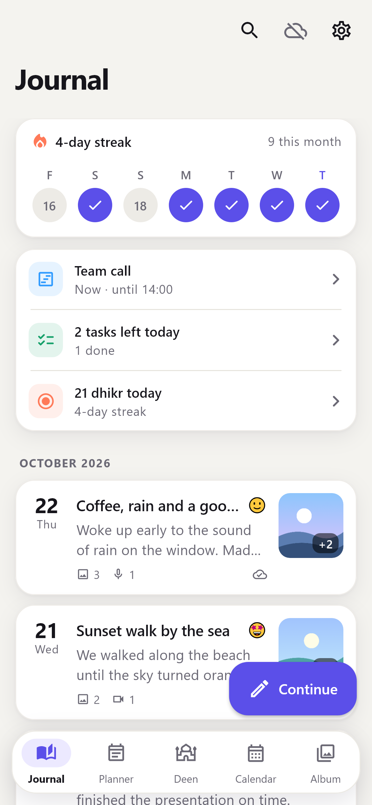
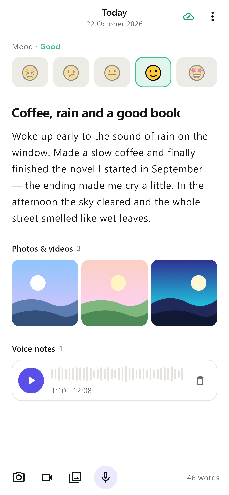
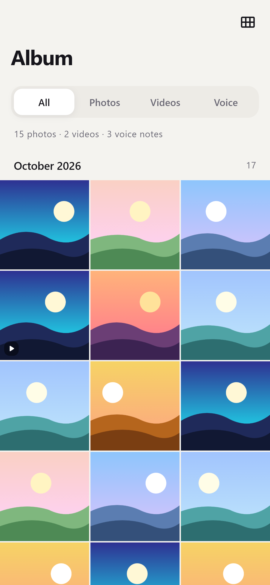
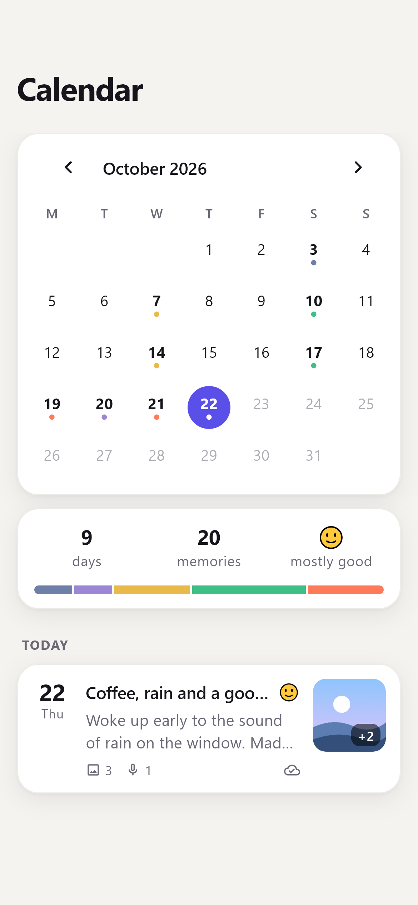
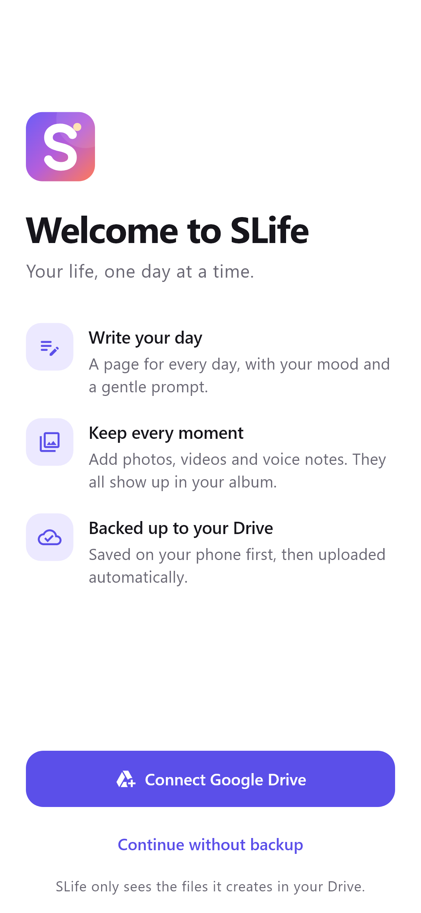
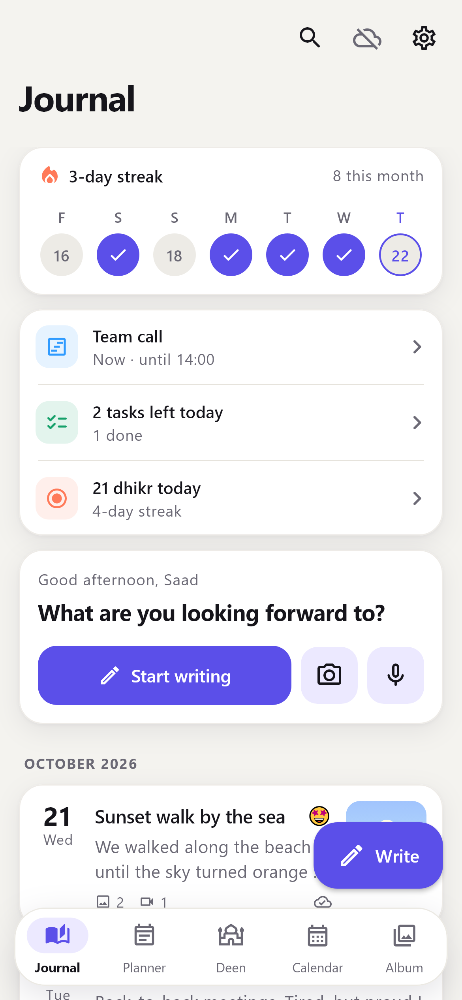
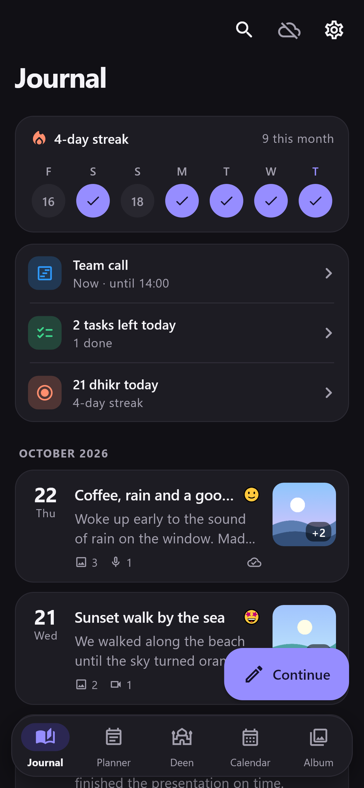
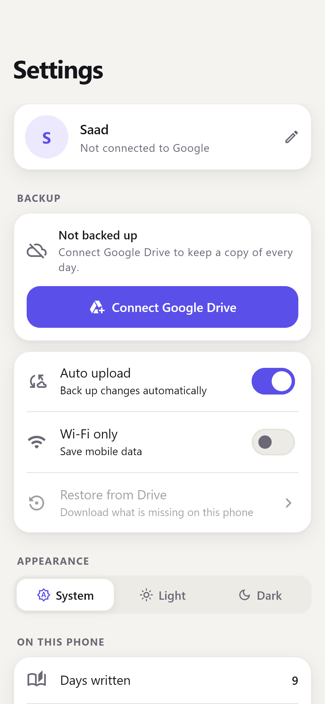

<p align="center"></p>

<h1 align="center">SLife</h1>
<p align="center"><i>Your life, one day at a time.</i></p>

SLife is a Flutter journaling app. Write about your day, pick a mood, and attach
photos, videos and voice notes. Everything is saved on your phone first and then
uploaded automatically to **your own Google Drive**, with one folder per day.

<p align="center">
  
  
  
  
</p>
<p align="center">
  
  
  
  
</p>

> The screenshots come from `tool/screenshots_test.dart`. That tool uses Windows system
> fonts in place of the app's Google Font (Inter), so the real
> app looks slightly different.

## Features

- **A page for every day**: title, story, mood (5 levels) and a daily writing prompt. It saves automatically while you type.
- **Photos & videos**: take them with the camera or pick several at once from the gallery.
- **Voice notes**: a built-in recorder with a live waveform, pause/resume, and a player with seeking.
- **Album**: photos, videos and voice notes from every day. View as a grid (2–5 per row, pinch to resize), by day with title and mood, or by month, plus "On this day" memories. Full-screen viewer with pinch-zoom and video playback.
- **Calendar**: days colored by mood, a mood summary for each month, and you can write for any past day.
- **Day planner**: split any day into colored time blocks, check them off, see what's on *Now*, and copy the day before.
- **Task manager**: quick add, due dates, priorities, Today / Upcoming / No date / Done filters, swipe to delete with undo. Tasks due on a day also show in that day's plan.
- **Tasbih**: a tap counter with targets (33, 99, 100, custom), the after-prayer sequence (33 · 33 · 34), your own dhikr, haptics, and daily stats with a streak. A full-screen focus mode lets you count by tapping anywhere.
- **Quran**: all 114 surahs in Uthmani script, bundled in the app (works offline, opens instantly). Read ayah by ayah or as a continuous mushaf, jump by surah, juz or ayah, search words in Arabic or in the translation, bookmarks and "continue reading". English or French translation downloads once (about 1 MB).
- **Search** across all titles and stories.
- **Stats**: writing streak, days written and number of memories.
- **Google Drive backup**: works offline first, uploads automatically, can be limited to Wi‑Fi, and can restore onto a new phone.
- **Light & dark themes**: follows the system theme, or you can choose one.
- **Designed for speed**: one tap to write (the button shrinks while you scroll), the keyboard opens straight away on a new page, pull down to back up, a week strip to jump to recent days, and a "Today" shortcut in the calendar.

## How the backup works

```
My Drive/
└── SLife/
    ├── slife-data.json     ← planner, tasks, tasbih history, Quran bookmarks
    ├── 2026-10-11/
    │   ├── journal.txt        ← your words, human readable
    │   ├── entry.json         ← metadata used for restoring
    │   ├── images/IMG_20261011_181500_ab12.jpg
    │   ├── videos/VID_20261011_190210_c3d4.mp4
    │   └── audios/AUD_20261011_221005_e5f6.m4a
    └── 2026-10-12/
        └── …
```

1. **Local first.** Text goes into SQLite and media files go into the app's documents folder. The on-device layout matches the Drive layout. The app works fully offline.
2. **Auto upload.** About 4 seconds after any change, SLife uploads whatever is new. It also syncs when the app opens or returns to the foreground, when the network comes back, and every 15 minutes while the app is open. Large videos use resumable uploads.
3. **Edits** overwrite `journal.txt` / `entry.json` in place. **Deletions** move the Drive file or folder to the Drive **trash**, so you can recover it for 30 days.
4. **Self-healing.** If you delete a day folder (or the whole `SLife` folder) in Drive, SLife uploads it again.
5. **Restore.** When you connect Drive on a new phone, SLife finds your `SLife` folder and offers to download it. You can also do this later from *Settings → Restore from Drive*. Days already on the phone are kept as they are.

SLife only requests the **`drive.file`** scope. It can see the files it created and nothing else in your Drive.

## Getting started

Requirements: Flutter 3.47+ (Dart 3.13) and Android Studio / an Android device (API 24+).
iOS works too, but you have to build it on a Mac.

```bash
flutter pub get
flutter run
```

The app is fully usable without Google Drive. To turn on backup, set up Google Sign-In once (next section).

## Connect Google Drive (one-time setup)

You need a free Google Cloud project that owns the OAuth client IDs.

1. Open <https://console.cloud.google.com/> and **create a project** (for example “SLife”).
2. Go to **APIs & Services → Library**, search for **Google Drive API** and click **Enable**.
3. Go to **Google Auth Platform → Branding / Audience** (the “OAuth consent screen”):
   - User type **External**, app name **SLife**, and your email address.
   - Under **Data access**, add the scope `https://www.googleapis.com/auth/drive.file`.
   - While the app is in *Testing*, add your Google account under **Test users**.
4. Go to **Clients → Create client → Android**:
   - Package name: `com.slife.slife` (set in `android/app/build.gradle.kts`)
   - SHA-1 certificate fingerprint of your signing key. For debug builds, run:
     ```bash
     cd android && ./gradlew signingReport
     ```
     or `keytool -list -v -keystore ~/.android/debug.keystore -alias androiddebugkey -storepass android -keypass android`.
     Add a second Android client for your release key when you publish.
5. Go to **Clients → Create client → Web application** (name it “SLife server”). Copy its **Client ID**.
   Android uses this ID as the `serverClientId`.
6. Paste the web client ID into `lib/config.dart`:
   ```dart
   static const String googleWebClientId = String.fromEnvironment(
     'SLIFE_WEB_CLIENT_ID',
     defaultValue: '1234567890-abc123.apps.googleusercontent.com',
   );
   ```
   or pass it at build time without editing code:
   ```bash
   flutter run --dart-define=SLIFE_WEB_CLIENT_ID=1234567890-abc123.apps.googleusercontent.com
   ```
7. **iOS only:** create a **Clients → iOS** client with bundle ID `com.slife.slife`.
   Set its ID as `SLIFE_IOS_CLIENT_ID` (in `config.dart` or with `--dart-define`).
   Then, in `ios/Runner/Info.plist`, replace `com.googleusercontent.apps.YOUR-IOS-CLIENT-ID`
   with the client's **reversed** ID.

Then open the app and tap **Connect Google Drive**, either during onboarding or in *Settings*.

**Troubleshooting:** If sign-in says *“not configured correctly”* or closes immediately with “cancelled”, the cause is almost always one of these: a wrong SHA-1, a package name that doesn't match, a missing web client ID, or your account not being listed as a test user.

## Project structure

```
lib/
├── main.dart                 bootstraps storage → database → auth → sync
├── app.dart                  MaterialApp, themes, onboarding gate
├── config.dart               Google OAuth client IDs, Drive folder name
├── theme/app_theme.dart      colors, sunrise gradient, typography
├── models/                   JournalEntry, MediaItem, Mood
├── data/
│   ├── database.dart         SQLite schema
│   ├── media_storage.dart    on-device folders, file naming, video thumbnails
│   └── journal_repository.dart  local source of truth (ChangeNotifier)
├── services/
│   ├── auth_service.dart     Google Sign-In + Drive authorization
│   ├── drive_service.dart    Drive v3 wrapper (folders, uploads, trash, download)
│   ├── drive_format.dart     journal.txt / entry.json writers & parser
│   ├── sync_service.dart     auto-upload engine + restore
│   └── settings_service.dart preferences
├── screens/                  onboarding, home shell, journal, calendar, album,
│                             settings, day editor, media viewer, search
└── widgets/                  cards, mood picker, audio player, voice recorder…
tool/
├── screenshots_test.dart     renders docs/screenshots (golden images)
└── generate_icons_test.dart  renders launcher icons
```

## Tests & tools

```bash
flutter test                                              # unit tests
flutter test tool/screenshots_test.dart --update-goldens  # regenerate screenshots
flutter test tool/generate_icons_test.dart                # regenerate app icons
```

## Notes

- **Background uploads.** Uploads run while SLife is open, and for a short time after you leave it. Anything still waiting is uploaded the next time you open the app. Mobile operating systems don't let an app keep a Google session running in the background indefinitely.
- **Fonts.** The fonts are downloaded from Google Fonts on first launch and then cached. To bundle them inside the app instead, put the `.ttf` files in `assets/google_fonts/` (see the `google_fonts` package docs).
- **Release builds.** Before publishing, set up your own signing config in `android/app/build.gradle.kts`, register the release SHA-1 in Google Cloud, and publish the OAuth consent screen.
